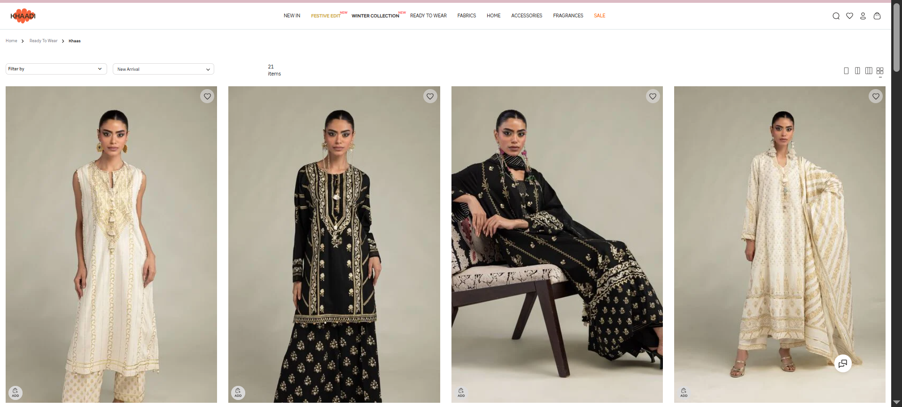

# Khaadi-Inspired E-commerce Website

## Assignment 2 — Static Responsive E-commerce Pages

### Project Description

This project is a static, responsive e-commerce website inspired by Khaadi, a Pakistani fashion and clothing brand.

The website is developed using HTML5, CSS3, and Bootstrap 5. It demonstrates responsive web design, product cards, navigation, and product detail layouts.

The website contains two main pages: a homepage displaying eight clothing products and a product detail page displaying information about a selected product.

This project is created for educational purposes only and is not affiliated with Khaadi.

## Reference Website

**Website Name:** Khaadi

**Website URL:** https://pk.khaadi.com/

**Reference Screenshot:**

The design is inspired by Khaadi's online clothing store, particularly its navigation, product listing layout, and product presentation.

## Technologies Used

- HTML5 — Website structure and content.
- CSS3 — Custom styling, colors, spacing, and media queries.
- Bootstrap 5 — Responsive grid, navigation bar, buttons, and layout.

## Website Pages

### 1. Homepage — index.html

The homepage includes a navigation bar, website name, cart icon, promotional banner, eight product cards, and a footer.

Each product card displays a product image, name, price, and Add to Cart button.

### 2. Product Detail Page — product.html

The product detail page includes a larger product image, product name, price, description, quantity selector, Add to Cart button, and Continue Shopping link.

## Responsive Design

The website is designed to adapt to different screen sizes using Bootstrap's responsive grid system and CSS media queries.

- Mobile (375px): One product per row.
- Tablet (768px): Two products per row.
- Desktop (1200px): Four products per row.

## How to Run the Website

1. Download or extract the assignment-2 folder.
2. Open the folder in Visual Studio Code.
3. Open index.html in a web browser.
4. Click the first product image to view its detail page.
5. Use the Continue Shopping link to return to the homepage.

An internet connection is required to load Bootstrap from its CDN.

## Note

This is a static website. The shopping cart and Add to Cart buttons are not functional because JavaScript functionality is outside the scope of this assignment.

Product names, prices, and descriptions are illustrative and may not match the official Khaadi website.

## Educational Purpose

This website was developed as part of Web Technologies Assignment 2 to demonstrate HTML, CSS, Bootstrap, and responsive web design.